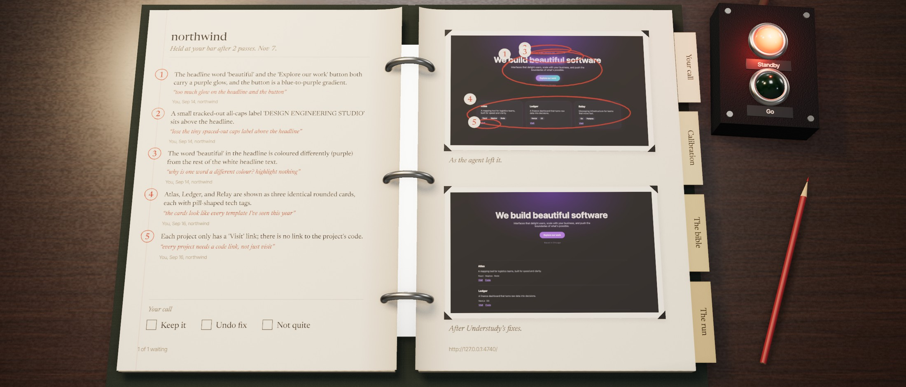
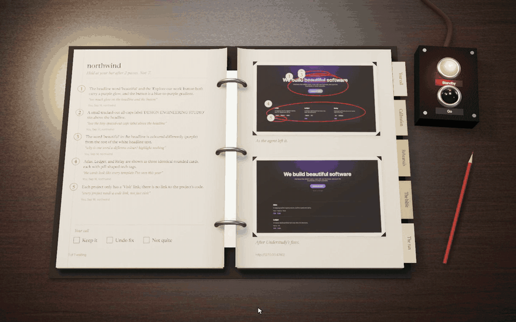
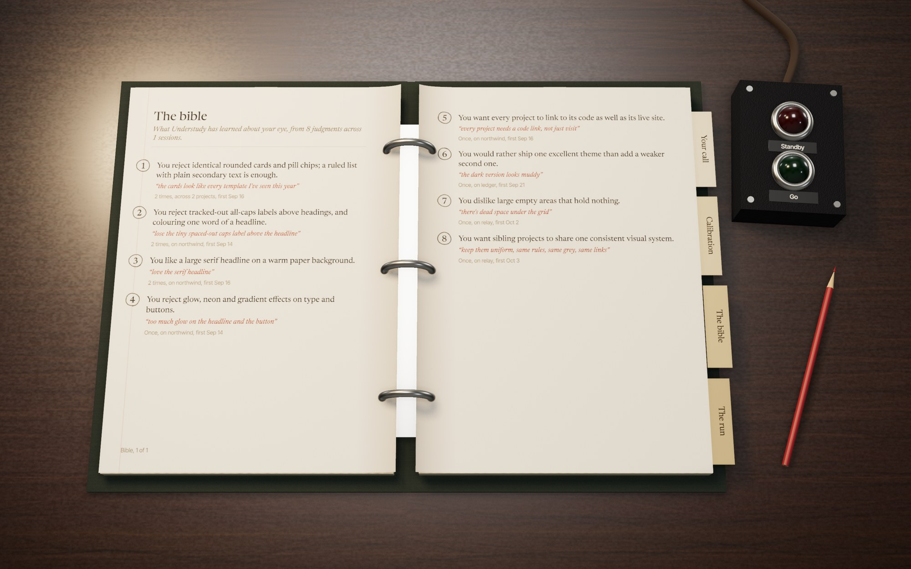
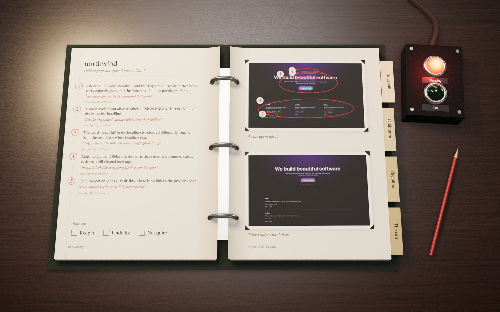
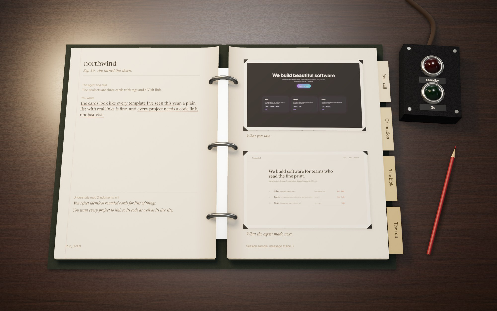

<p align="center">
  
</p>

<p align="center">
  <a href="#what-it-learns">What it learns</a>&nbsp;&nbsp;&nbsp;
  <a href="#holding-an-agent-to-it">Holding an agent to it</a>&nbsp;&nbsp;&nbsp;
  <a href="#the-book">The book</a>&nbsp;&nbsp;&nbsp;
  <a href="#local-and-claude">Local and Claude</a>&nbsp;&nbsp;&nbsp;
  <a href="#set-it-up">Set it up</a>&nbsp;&nbsp;&nbsp;
  <a href="#privacy">Privacy</a>&nbsp;&nbsp;&nbsp;
  <a href="#whats-next">Next</a>
</p>

<br />

If you build with a coding agent, you re-teach it your taste in every session. It shows you a screen, you say what's wrong, it tries again. Then the next project starts from zero.

Those judgments are already written down. They're in your Claude Code session logs, in your own words, next to the screenshots you were reacting to. Understudy reads them, works out the design bar they add up to, and holds every agent's UI work to that bar before you see it. When a screen misses, the agent fixes it, and you get the before and after with the reasons. Every reason cites the moment you taught it, in the words you used.

<p align="center">
  
</p>
<p align="center"><sub>Every image here uses the sample dataset in <code>tools/sample.ts</code>, a made-up designer working on a made-up studio site. The fix shown was made by a real Claude Code agent under Understudy's hook.</sub></p>

The name is from the theatre. An understudy watches the lead every night, rehearses offstage, and only goes on when they're ready.

<br />

## What it learns

Understudy reads your Claude Code sessions in four steps. Each one is a command you can run and inspect on its own.

1. **Archive.** Claude Code deletes old session logs after a while. Understudy copies every session somewhere it won't be cleaned up, and a hook keeps doing it at the end of each session.
2. **Mine.** It finds every message you typed, the screenshots the agent had just shown you, and the screenshots it took in reply. Resumed sessions repeat earlier messages, so duplicates are dropped.
3. **Read.** Claude reads each message that sounds like a design judgment and pulls out every separate judgment in it, with the exact words that carry it. A quote that isn't really in your message is thrown away.
4. **Distil.** The readings are folded into a short list of statements about your taste. That list is the bible, and every statement points back at the moments it came from.



## Holding an agent to it

Understudy installs as a Claude Code plugin. When an agent finishes a turn that changed UI files, the plugin screenshots your running page and judges it:

- A small vision model on your Mac takes a quick first look and flags common tells of generated UI.
- Local embeddings find the past judgments of yours that apply to this screen.
- Claude judges the screenshot against those judgments and the bible. It may only raise a note that one of your judgments supports, or an obvious defect anyone would call broken. It may not judge from general taste.

If the screen misses, the hook stops the agent from finishing and hands it the notes. It fixes them and tries to stop again, which triggers a re-check. A re-check asks whether last round's notes were fixed, so the goalposts don't move, and after three rounds Understudy stops and shows you the best attempt instead of looping.

Fixes are allowed to change how things look and are arranged, never what they say. That rule came from the first real test, where an agent invented a statistic to fill an empty hero. Notes also describe preferences, never history: in the second test the judge told the agent it had "reversed an approved choice" on a page that had never looked that way, and the agent refused, rightly.

Here is the sample run. A headless agent was asked to add one line under the hero of a stock-looking studio page. Understudy failed the result on five notes, each tied to something the sample designer had said, and the agent fixed all five in one round: the glow came off the headline and button, the caps label went, the headline lost its one coloured word, the cards became a ruled list with plain tags, and every project got a Code link. The re-check confirmed each note was resolved and let it stop. The agent spent 14 cents, the two checks about 8.



## The book

Everything Understudy knows opens as a stage manager's prompt book on a desk, built in three.js the way a product shot is lit: one warm lamp, real shadows, paper you can turn.

- **Your call** holds each fix waiting on you. The notes are typed on the left, your words in red, with the cue numbers circled in pencil. The before and after are pasted on the right. Click a print and it lifts off the page so you can read it. Tick Keep it, Undo fix or Not quite, and the cue light on the desk goes from red to green. Undo reverses the fix's exact diff, and refuses if the code has moved on underneath it.
- **The bible** is what it has learned, one statement at a time.
- **Calibration** shows two renders of one of your own pages that differ in exactly one thing. Pick the one that reads more like you, and the next pair turns up.
- **The run** is every judgment it learned from, one to a spread: what the agent had said, what you wrote with the judgment underlined in red, what you were looking at, and what the agent made next.



## Local and Claude

| Job | Runs on |
| --- | --- |
| Archiving, mining, indexing | Plain code on your Mac |
| Matching a new screen to past judgments | `nomic-embed-text` in Ollama, on your Mac |
| A fast first look at a screenshot | `qwen2.5vl:7b` in Ollama, on your Mac |
| Reading judgments, distilling the bible, judging a screen | Claude, through your own Claude Code |
| Fixing what missed | The Claude Code session that made it |

Reading about two hundred judgments once cost $3.65 of Claude usage; after that only new sessions are read. A check costs about 4 cents, and planning four calibration pairs 6 to 16 cents.

Understudy calls Claude through `claude -p` with your settings, plugins, MCP servers and tools switched off, and with session saving off, so it never reads its own calls back as your judgments.

## Set it up

You need Node 22.13 or newer, Claude Code, and optionally [Ollama](https://ollama.com) for the local half.

```sh
git clone https://github.com/AllStreets/understudy && cd understudy
npm install && npm link            # puts `understudy` on your PATH
ollama pull nomic-embed-text && ollama pull qwen2.5vl:7b   # optional
understudy learn                   # archive, mine, read, index, distil
understudy serve                   # the book, on http://127.0.0.1:4730
```

Then add the plugin in Claude Code, and tell each project where its page runs:

```sh
/plugin marketplace add AllStreets/understudy
/plugin install understudy@understudy
echo '{ "url": "http://localhost:5173/" }' > .understudy.json
```

You can also check any page or screenshot by hand:

```sh
understudy check http://localhost:5173/
understudy undo <check id>
understudy calibrate http://localhost:5173/    # pairs to pick between in the book
```

To try it without any history of your own, build the sample and open the book on it:

```sh
UNDERSTUDY_HOME=$PWD/.understudy-local/sample npx tsx tools/sample.ts
UNDERSTUDY_HOME=$PWD/.understudy-local/sample UNDERSTUDY_PORT=4732 understudy serve
```

## Privacy

Everything stays in `~/Library/Application Support/Understudy`: the archive, the screenshots, the database. Nothing is uploaded anywhere except the text and screenshots each Claude call needs, sent through your own Claude Code. Sessions run in temporary folders are never archived.

## What's next

The design document is in [docs/specs](docs/specs/2026-11-07-understudy-design.md). Still to build:

- **Teaching a task**: do it once while Understudy watches, and it writes the task down as a procedure, rehearses it in a copy of the project, and offers to take it over once a rehearsal passes.
- **A local scorer** trained on your Keep and Not quite calls, so more of the judging moves onto your Mac over time.

## License

MIT
