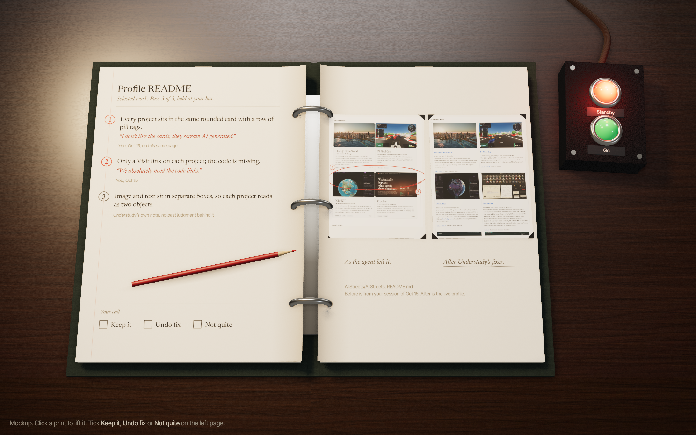

# Understudy

Understudy learns your design bar from the Claude Code sessions you've already had, holds every agent's UI work to it before you see it, fixes what misses, and shows you the before and after with the reasons. Each reason cites the moment you taught it.



This is early. The archive and the miner work today on real sessions; the prompt book above is the design the app is being built toward. Progress is tracked in [the design document](docs/specs/2026-11-07-understudy-design.md).

## Why

If you build with an agent, you re-teach your taste in every session. It shows you a screen, you say what's wrong, it tries again. The next project starts from zero. Those judgments are already written down, in your own words, next to the screenshots you were reacting to. They're sitting in `~/.claude/projects`, and Claude Code deletes them after a while.

On my Mac, the miner found 586 messages I typed across 21 sessions. 202 of them judge how something looks or feels, and 136 of those sit right beside the screenshot I was looking at. "I don't like the cards, they scream AI generated." "I hate dead space." "We absolutely need the code links." That's a design bar, and it's specific enough to hold an agent to.

## What works now

```sh
npm install
npm run cli -- archive   # copy every Claude Code session log somewhere it won't be deleted
npm run cli -- mine      # find what you typed, what you saw before it, and what came after
npm run cli -- stats     # judgments per project
```

Everything stays in `~/Library/Application Support/Understudy`. Nothing leaves your Mac.

## License

MIT
